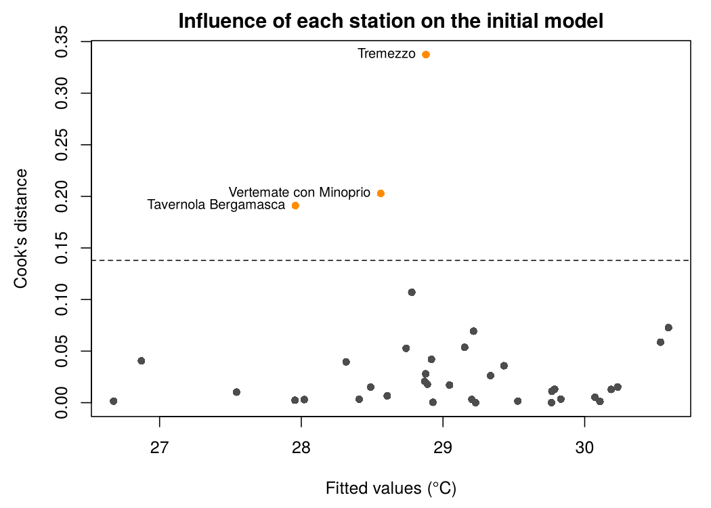
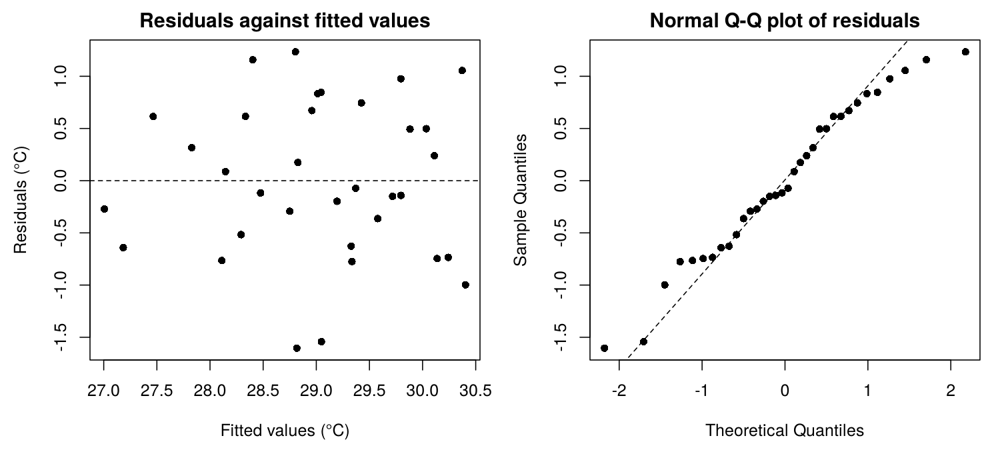
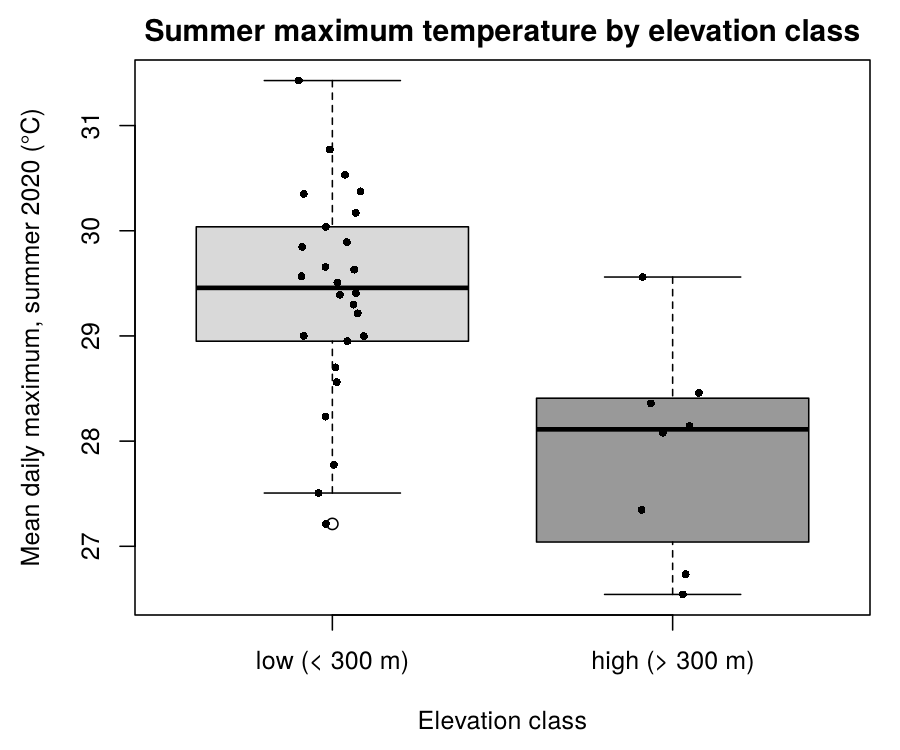
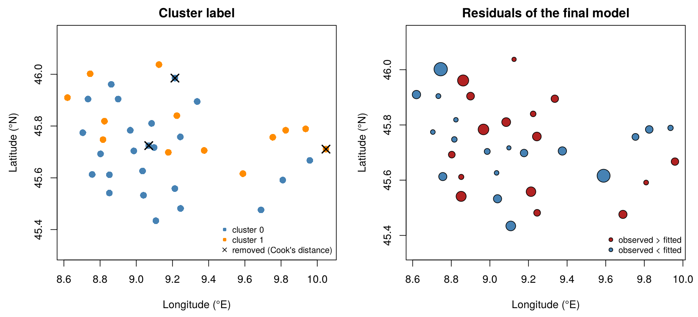

# Summer Maximum Temperatures in Lombardy: A Regression Study in R

This project asks which geographical factors explain the differences in summer maximum temperature between weather stations in north-western Lombardy (Italy). It uses station-level summaries of summer 2020 from the ARPA Lombardia monitoring network and applies the standard tools of a first course in statistical inference: multiple linear regression with influence analysis and variable selection, one-way ANOVA, confidence and prediction intervals, and cross-validation.

The work was carried out as a group project for the course *Models and Methods for Statistical Inference* (BSc in Mathematical Engineering, Politecnico di Milano, academic year 2024/25) and later reorganised into a documented R codebase.

**Authors:** Eleonora Barbaglia, Claudia Berra, Stefano Carlo de Caro, Gaia Di Paolo.

## Question and data

The response is the mean daily maximum temperature over summer 2020 at each station (`tmax_summer`, °C). The dataset contains 37 stations in the provinces of Milan, Bergamo, Como, Lecco and Varese, with one row per station:

| Variable | Description |
| --- | --- |
| `latitude`, `longitude`, `altitude_m` | Station coordinates (decimal degrees) and altitude (m) |
| `tmin_summer`, `tmax_summer`, `tmean_summer` | Mean daily minimum, maximum and mean temperature, summer 2020 (°C) |
| `trange_summer` | Mean daily temperature range (°C) |
| `precip_summer` | Mean daily precipitation, summer 2020 (mm) |
| `elevation_class` | `low` (104–296 m, 27 stations) or `high` (309–535 m, 10 stations) |
| `lakeside` | Whether the station lies on a lake shore (12 stations) |
| `cluster` | Two-group cluster label of the stations, computed separately from their daily maximum temperatures |

The other temperature summaries are computed from the same daily records as the response, so they are not used as predictors. In the full sample, the response is negatively correlated with longitude (−0.48), altitude (−0.43) and latitude (−0.38), and only weakly with precipitation (−0.17) ([correlation matrix](results/correlation_matrix.csv)). See [data/README.md](data/README.md) for provenance and coding notes.

## Method

1. **Initial model.** `tmax_summer` is regressed on elevation class, latitude, longitude, the interactions of elevation class with each coordinate, precipitation and lake proximity.
2. **Influence analysis.** Stations with Cook's distance above 4/(n − p) in the initial model are removed: Tavernola Bergamasca, Tremezzo and Vertemate con Minoprio. 34 stations remain.
3. **Variable selection.** Backward elimination with partial F-tests at the 5% level removes, in order, precipitation, lake proximity and the two interactions ([log](results/backward_elimination.txt)).
4. **Final model and diagnostics.** `tmax_summer ~ elevation_class + latitude + longitude`, checked for collinearity (VIF), constant residual variance and normality of the residuals (Q-Q plot and Shapiro-Wilk test).
5. **ANOVA.** A one-way ANOVA compares the two elevation classes, after checking normality within groups and equality of variances (Bartlett and Levene tests).
6. **Intervals.** Simple regressions on latitude and on longitude give 95% confidence intervals for the mean response and 95% prediction intervals for a new station.
7. **Cross-validation.** Leave-one-out and repeated 5-fold cross-validation estimate the out-of-sample error of the final model.

## Results

Final model on 34 stations ([summary](results/final_model_summary.txt)):

| Term | Estimate | Std. error | p-value |
| --- | ---: | ---: | ---: |
| Intercept | 211.6 | 45.5 | 6.3 × 10⁻⁵ |
| High elevation class | −0.91 °C | 0.34 | 0.012 |
| Latitude (per degree) | −3.70 °C | 0.97 | 6.2 × 10⁻⁴ |
| Longitude (per degree) | −1.42 °C | 0.38 | 8.5 × 10⁻⁴ |

- R² = 0.591 (adjusted 0.550); residual standard error 0.785 °C; F = 14.44 on 3 and 30 degrees of freedom, p = 5.3 × 10⁻⁶.
- Collinearity is low (maximum VIF 1.19). The residuals show no visible pattern against the fitted values, and the Shapiro-Wilk test does not reject normality (p = 0.44).
- Precipitation and lake proximity are not significant once location and elevation are included. In the initial model on all 37 stations, R² is 0.582 (adjusted 0.481).
- **Elevation.** The one-way ANOVA rejects equal means for the two elevation classes: F(1, 32) = 13.55, p = 8.5 × 10⁻⁴. The mean is 29.39 °C for low stations (n = 26) and 27.90 °C for high stations (n = 8), a difference of 1.48 °C. Normality within groups and equal variances are not rejected (Bartlett p = 0.99, Levene p = 0.93) ([output](results/anova_elevation.txt)).
- **Single coordinates.** Latitude alone explains 20% of the variance and longitude alone 17%. The 95% prediction intervals are about four times as wide as the confidence intervals for the mean (average widths 4.5 °C and 1.1 °C) ([output](results/prediction_intervals.txt)).
- **Cross-validation.** Leave-one-out gives MSE = 0.704 °C² (RMSE 0.84 °C) and R²_cv = 0.470. Repeated 5-fold cross-validation (100 repetitions) gives MSE = 0.726 ± 0.059 °C² and R²_cv = 0.454 ± 0.045 ([output](results/cross_validation.txt)).

Selected figures:

| | |
| --- | --- |
|  |  |
|  |  |

The station map shows that the cluster label groups some neighbouring stations together (for example most stations in the Milan area), but the two groups are not separated by a clear spatial boundary. This is consistent with a model in which elevation explains part of the variation and the stations cover a small geographical area.

## Presentation

The project presentation is available as [PDF](presentation/lombardy-summer-temperature-analysis.pdf) and [PowerPoint](presentation/lombardy-summer-temperature-analysis.pptx). It reports the same numbers as the files in `results/`.

## Limitations

- The sample is small (37 stations, 34 after the influence analysis) and covers a single summer, so the results describe summer 2020 in this area and should not be read as a climatological relationship.
- Influential points were removed and variables selected on the same data used for cross-validation. The cross-validated error is therefore optimistic; a nested procedure would repeat both steps inside each fold.
- Stations are treated as independent observations. Spatial correlation between nearby stations is not modelled.
- Elevation enters only as a two-level class; altitude itself, distance from the lakes and urbanisation are not modelled.
- The seasonal summaries were computed by the group from daily records before the analysis. That aggregation step is not part of this repository.

## Reproduce the analysis

R 4.3 or later and the CRAN package `car` are required:

```r
install.packages("car")
```

The station data file is not distributed with the repository (see [data/README.md](data/README.md)); the generated tables and figures are included. With `data/station_summaries_summer2020.csv` in place, run from the repository root:

```text
Rscript scripts/run_all.R
```

The scripts can also be run one at a time, in numerical order, from the repository root. They write tables and text summaries to `results/` and figures to `figures/`, and need no internet connection, map service or API key.

The pipeline was verified with R 4.3.3 on Linux x86-64 (car 3.1-2, carData 3.0-5). All numbers in this README are taken from the files in `results/`.

## Repository structure

```text
.
├── R/
│   └── common.R                 # data loading, model formulas, helpers
├── data/
│   ├── README.md                # provenance, licence and coding notes
│   └── station_summaries_summer2020.csv   # not distributed
├── figures/                     # figures generated by the scripts
├── presentation/                # project presentation (PDF and PowerPoint)
├── results/                     # tables and text output generated by the scripts
└── scripts/
    ├── 01_exploration.R         # descriptive statistics and correlations
    ├── 02_regression.R          # initial model, Cook's distance, selection, final model
    ├── 03_anova_elevation.R     # one-way ANOVA by elevation class
    ├── 04_prediction_intervals.R
    ├── 05_cross_validation.R
    ├── 06_station_map.R
    └── run_all.R
```

## Data source

Temperature and precipitation measurements: ARPA Lombardia (Agenzia Regionale per la Protezione dell'Ambiente della Lombardia), regional weather monitoring network. The station-level summaries were derived by the authors. See [data/README.md](data/README.md).
